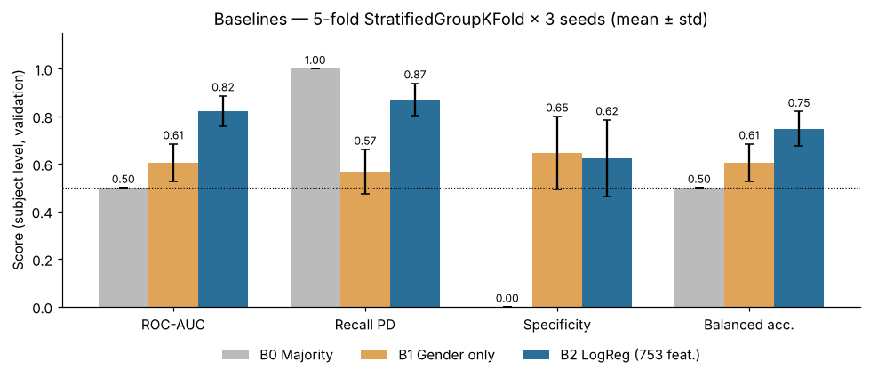
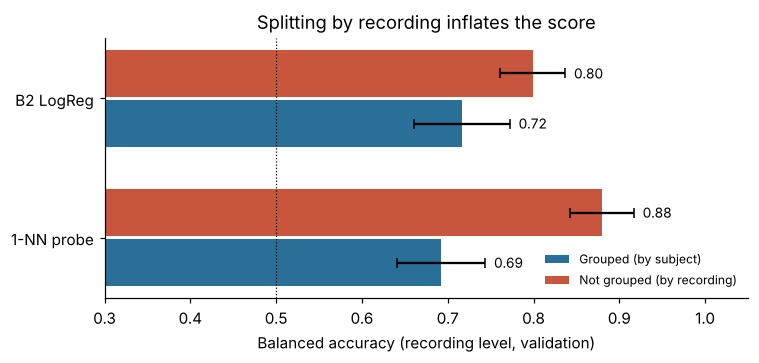

# Voice-Based Screening of Parkinson's Disease

Machine Learning final project / Armelle ADAM, Lola COCHE

**Question:** using only acoustic features of a sustained vowel, can a classical classifier detect Parkinson's disease (PD)
in a person it has never heard and how many of the 753 features does it need?

**Dataset:** [UCI Parkinson's Disease Classification](https://archive.ics.uci.edu/dataset/470/parkinson+s+disease+classification)
(Sakar et al., 2018, CC BY 4.0). 756 recordings of 252 people (3 each): 188 PD, 64 healthy; 753 features + gender.

---

## Progress

| Week | Milestone | Status | Where |
|---|---|---|---|
| 1 | Project definition, dataset, EDA | ✅ Done | `notebooks/week1_eda.ipynb`, specification document |
| 2 | Data preparation and baseline | ✅ Done | `notebooks/week2_preparation_baseline.ipynb` |
| 3 | Models, feature selection, tuning | ⏳ Next | ... |
| 4 | Final test evaluation, report, oral | ⬜ To do | ... |

### Week 1 — key findings (EDA)
- No missing values; 1 duplicated recording (subject 37, kept: same person, same split).
- Imbalance 2.9 : 1 (majority-class accuracy = 74.6 %) → ROC-AUC and balanced accuracy as main metrics.
- Feature scales from 1e-20 to 1e10 → `StandardScaler` inside the pipeline.
- 1,949 feature pairs with |r| > 0.9 and 153 features with zero mutual information → feature selection in Week 3.
- **For 68 % of recordings, the nearest other recording is the same person** → every split is done by subject.
- Gender is confounded with the class (controls 64 % women, patients 57 % men).

### Week 2 — data preparation and baseline
**Cleaning:** all integrity checks are `assert`s (binary target, 3 recordings per subject, constant label per subject, no NaN/inf).
No row or column removed; decisions justified in the notebook (§2). Output: `data/processed/pd_speech_clean.csv`.

**Split (frozen):** 252 subject ids split 80/20, stratified on class × gender, `random_state=42` → `data/processed/split.csv`.

| Set | Subjects | Recordings | PD | Healthy | % male |
|---|---|---|---|---|---|
| Train (+ validation by CV) | 201 | 603 | 150 | 51 | 51.2 |
| Test — not used before Week 4 | 51 | 153 | 38 | 13 | 52.9 |

**Validation:** 5-fold `StratifiedGroupKFold` (groups = subject) × 3 seeds on the training subjects.

**Baselines** — subject level (mean of a person's 3 probabilities), validation folds, mean ± std over 15 folds:

| Model | ROC-AUC | Recall PD | Specificity | Balanced acc. |
|---|---|---|---|---|
| B0 Majority class | 0.50 ± 0.00 | 1.00 ± 0.00 | 0.00 ± 0.00 | 0.50 ± 0.00 |
| B1 Gender only | 0.61 ± 0.08 | 0.57 ± 0.09 | 0.65 ± 0.15 | 0.61 ± 0.08 |
| **B2** StandardScaler + LogReg (balanced), 753 features | **0.82 ± 0.06** | 0.87 ± 0.07 | 0.62 ± 0.16 | **0.75 ± 0.07** |

- B2 overfits: training ROC-AUC = 1.00 vs 0.82 in validation → Week 3 must reduce complexity (regularization, feature selection).
- Weak point: specificity, especially for healthy men (0.50 vs 0.67 for women).
- F1 on PD is not informative here: the useless B0 already gets 0.86.

**Leakage check:** splitting by recording instead of by subject inflates balanced accuracy by +0.08 (B2: 0.72 → 0.80)
and by +0.19 for a 1-nearest-neighbour probe (0.69 → 0.88), which just recognizes the same voice.

<p></p>
<p></p>

### Week 3 plan
Tune `C` of B2; feature selection **inside** the CV pipeline (mutual-information filter, RFE, L1 logistic regression);
kNN, SVM-RBF, decision tree; `class_weight` vs SMOTE; model without `gender`. Same folds and seeds as Week 2.

---

## Project structure
```
.
├── README.md
├── requirements.txt              # pinned versions (Python 3.13)
├── data/
│   ├── raw/
│   │   └── pd_speech_features.csv        # raw data, never modified
│   └── processed/
│       ├── pd_speech_clean.csv           # clean dataset (Week 2)
│       └── split.csv                     # frozen subject-level split: id -> train / test
├── notebooks/
│   ├── week1_eda.ipynb                   # Week 1: exploratory data analysis
│   └── week2_preparation_baseline.ipynb  # Week 2: cleaning, split, baselines, leakage check
├── results/
│   ├── fig1_target_gender.png … fig4_relevance.png   # Week 1 figures
│   ├── fig5_baselines.png, fig6_leakage.png          # Week 2 figures
│   ├── week2_cv_results.csv              # every fold, every metric
│   ├── week2_leakage_check.csv
│   └── week2_confusion_B2.csv
├── report/                               # Report_Group_XX.pdf (Week 4)
└── ai_governance/
    ├── CONTRIBUTIONS.md                  # module ownership matrix
    ├── PROMPT_LOG.md                     # high-stakes LLM prompts
    └── AI_AUDIT.md                       # flaws caught in AI output
```

## How to run
```bash
pip install -r requirements.txt
cd notebooks
jupyter nbconvert --to notebook --execute --inplace week2_preparation_baseline.ipynb
```
**On Google Colab:** open a notebook from this repo (File → Open notebook → GitHub tab); its first code cell clones the repo so the paths work.

All paths are relative to `notebooks/`. Seeds: split `random_state=42`, CV seeds 0, 1, 2. Runtime ≈ 15 s.

**Rule:** the 51 test subjects in `split.csv` are not used by any notebook before the Week 4 final evaluation.
